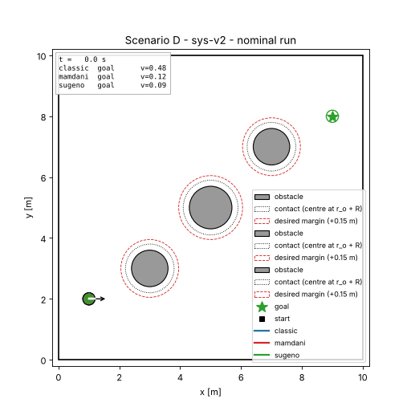
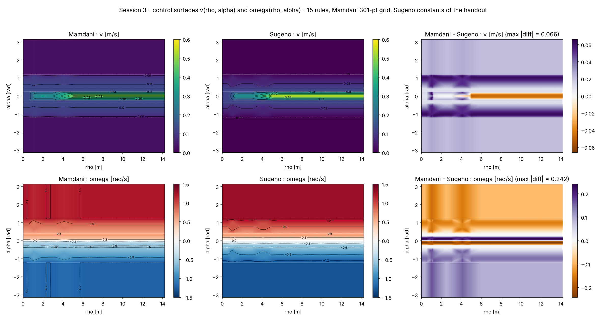
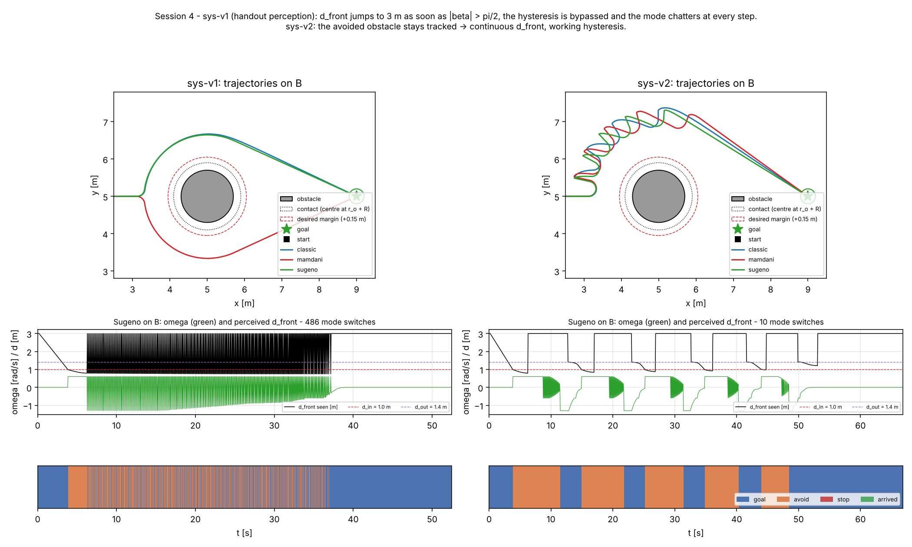

# Fuzzy navigation of a mobile robot: Classic vs Mamdani vs Sugeno

Soft Computing mini-project (ENSI). A differential-drive robot has to reach a target
and avoid fixed obstacles in a 10 m × 10 m arena. Three controllers share the same
interface and the same supervisor, and are compared under a reproducible protocol:

- a **classic** proportional law;
- a **Mamdani** fuzzy controller;
- a **Sugeno** fuzzy controller, with the fuzzy engine written from scratch.

Two soft-computing extensions are also included: an **MLP** that imitates the fuzzy
controller, and a **genetic algorithm** that tunes the Sugeno system.

<p align="center">
  
</p>

## Highlights
- **Fuzzy engine from scratch** (`fuzzy.py`). It covers triangles, trapezoids and shoulders, Mamdani (min / max / discrete centroid) and Sugeno order 0.
- **Verified three ways:**
  - against the hand calculation: 0.875 / 0.125 → 0.275;
  - against explicit sums;
  - against scikit-fuzzy, with a maximum difference of 3·10⁻³.
- **Reproducible protocol:**
  - tuning on maps A and B, validation on C, test on D, E and F;
  - 1 nominal run + 20 noisy seeds per method and map;
  - identical pre-generated noise for every controller;
  - collisions checked along each step's segment.
- **360 test episodes, 0 collisions.** The minimum real clearance stays above the 0.15 m safety margin.
- **Diagnosed supervisor flaw.** The "frontal obstacle" perception makes the 1.0 / 1.4 m hysteresis useless: 486 mode switches on a single run. A corrected version (`sys-v2`) brings this down to 10, but in the narrow passage it creates a symmetry deadlock that noise breaks. Both versions are frozen and evaluated.
- **Extensions:**
  - the MLP (32-16) reaches 0.003 m/s and 0.015 rad/s test error, yet a low imitation error does not guarantee good navigation;
  - the genetic algorithm (12 × 10, tournament, arithmetic crossover) is compared with random search at equal budget.
- **Interactive replay:** `viewer.html` replays the test runs in any browser.

## Results (test maps, `sys-v1`, 20 noisy runs each)
| Map | Classic | Mamdani | Sugeno |
|---|---|---|---|
| D (3 obstacles) | 20/20 arrivals, 42.9 s | 20/20, 77.1 s | 20/20, 89.3 s |
| E (1.2 m passage) | 20/20, 45.9 s | 20/20, **34.2 s** | 20/20, 55.8 s |
| F (start facing away) | 20/20, 30.7 s | 20/20, 53.4 s | 20/20, 59.0 s |

All tables are in [`results/RESULTS.md`](results/RESULTS.md). The analysis (in French) is in [`docs/analyse_resultats.md`](docs/analyse_resultats.md).

| Control surfaces | Chattering diagnosis |
|---|---|
|  |  |

## Run it
```bash
python -m venv .venv
.venv\Scripts\activate          # Linux / macOS: source .venv/bin/activate
python -m pip install -r requirements.txt
python -m unittest discover -s tests -v    # 27 tests
python run_experiments.py                  # full campaign, no manual input
python run_experiments.py --quick          # 2-minute smoke test
```
Then open `results/RESULTS.md`, the `figures/` folder, and `viewer.html`.

## Project layout
| File | Role |
|---|---|
| `model.py` | parameters, kinematics, wheel speeds, collision geometry |
| `sensors.py` | noisy pose observation (noise pre-generated per seed), obstacle perception |
| `fuzzy.py` | fuzzy inference engine (Mamdani, Sugeno) |
| `fuzzy_design.py` | partitions and rule tables (15 goal rules, 9 avoidance rules) |
| `controllers.py` | classic, fuzzy, MLP and avoidance controllers, common supervisor |
| `scenarios.py` | maps A–F and demo maps, JSON export |
| `simulator.py` | simulation loop, segment collision check, blocking monitor |
| `metrics.py` | per-episode metrics and aggregation |
| `sessions/` | one runner per lab session (1 to 6) |
| `run_experiments.py` | rebuilds every log, table and figure |
| `notebooks/` | step-by-step fuzzy inference |

Outputs: `configs/` (JSON maps and parameters), `logs/` (one CSV log per episode),
`results/`, `figures/`.

## Tech
Python · NumPy · Matplotlib · scikit-learn · fuzzy logic · genetic algorithms · reproducible experiments
