# Fuzzy navigation of a mobile robot: Classic vs Mamdani vs Sugeno

Soft Computing mini-project (ENSI). A differential-drive robot has to reach a target
and avoid fixed obstacles in a 10 m × 10 m arena. Three controllers share the same
interface and the same supervisor, and are compared under a reproducible protocol:

- a **classic** proportional law;
- a **Mamdani** fuzzy controller;
- a **Sugeno** fuzzy controller.

The fuzzy inference engine is written from scratch, with no fuzzy library. Two
soft-computing extensions are also included: an **MLP** that imitates the fuzzy
controller, and a **genetic algorithm** that tunes the Sugeno system.

<p align="center">
  <a href="https://sarra1011.github.io/soft-computing-robot-navigation/viewer.html"><b>▶ Open the live interactive replay</b></a>
  &nbsp;·&nbsp; <a href="results/RESULTS.md">All result tables</a>
  &nbsp;·&nbsp; <a href="docs/analyse_resultats.md">Analysis (FR)</a>
</p>

<p align="center">
  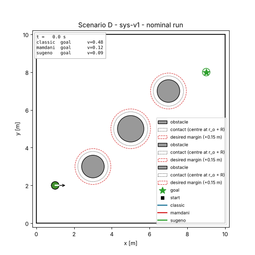
  
  <br><sub>Test scenario D, nominal run. Left: supervisor <code>sys-v1</code> (as in the handout). Right: <code>sys-v2</code> (corrected hysteresis). Blue = classic, red = Mamdani, green = Sugeno.</sub>
</p>

---

## Contents
1. [Highlights](#highlights)
2. [Problem and model](#problem-and-model)
3. [Fuzzy engine (session 2)](#fuzzy-engine-session-2)
4. [Goal seeking: Mamdani vs Sugeno (session 3)](#goal-seeking-mamdani-vs-sugeno-session-3)
5. [Obstacle avoidance and supervision (session 4)](#obstacle-avoidance-and-supervision-session-4)
6. [Comparative campaign on the test maps (session 5)](#comparative-campaign-on-the-test-maps-session-5)
7. [Extensions: neural imitation and genetic tuning (session 6)](#extensions-neural-imitation-and-genetic-tuning-session-6)
8. [Interactive replay viewer](#interactive-replay-viewer)
9. [Run it](#run-it)
10. [Project layout](#project-layout)
11. [Limitations](#limitations)

---

## Highlights
- **Fuzzy engine from scratch** (`fuzzy.py`). It covers triangles, trapezoids and shoulders (with no division by zero on plateaus), Mamdani (min / max / discrete centroid) and Sugeno order 0.
- **Verified three ways:**
  - against the hand calculation of the handout: 0.875 / 0.125 → 0.275;
  - against explicit sums;
  - against scikit-fuzzy, with a maximum difference of 3·10⁻³.
- **Reproducible protocol:**
  - tuning on maps A and B, validation on C, test on D, E and F;
  - 1 nominal run + 20 noisy seeds per method and map;
  - the same pre-generated noise sequence for every controller;
  - collisions checked along each step's segment, not only at its end points.
- **Cross-machine reproducibility.** The campaign run on a Kaggle CPU (numpy 2.1, scikit-learn 1.6) gives exactly the same trajectories and tables as on a local Linux machine (numpy 2.5, scikit-learn 1.9). Only the compute times differ.
- **360 test episodes, 0 collisions.** The minimum real clearance is about 0.39 m, above the 0.15 m safety margin.
- **Diagnosed supervisor flaw.** The handout's "frontal obstacle" perception makes the 1.0 / 1.4 m hysteresis useless: 486 mode switches on a single run. A corrected version (`sys-v2`) brings this down to 10, but in the narrow passage it creates a **symmetry deadlock** that only noise breaks. Both versions are frozen and evaluated.
- **Extensions:**
  - the MLP imitates Sugeno within 0.003 m/s and 0.013–0.020 rad/s, yet a low imitation error does not guarantee good navigation;
  - the genetic algorithm makes the robot faster at the cost of clearance.
- **27 unit tests.** One command (`python run_experiments.py`) rebuilds every log, table and figure.

---

## Problem and model
- **Robot:** a unicycle model, state q = (x, y, θ) and commands (v, ω).
- **Limits:** 0 ≤ v ≤ 0.60 m/s and |ω| ≤ 1.50 rad/s.
- **Simulation:** time step Δt = 0.05 s, at most 120 s per run.
- **Geometry:** robot radius 0.20 m. The robot has arrived when the distance to the target ρ ≤ 0.20 m.
- **Wheels:** Ω_R = (v + bω/2)/r and Ω_L = (v − bω/2)/r, with r = 0.05 m and b = 0.30 m.

The simulator keeps the **true state** separate from the **observations**. A controller only sees the estimated pose and the quantities derived from it. Arrival and collisions are always judged on the true state.

**Classic reference:** v = min(0.6, 0.8ρ)·max(0, cos α) and ω = clip(2α, ±1.5).

<p align="center">
  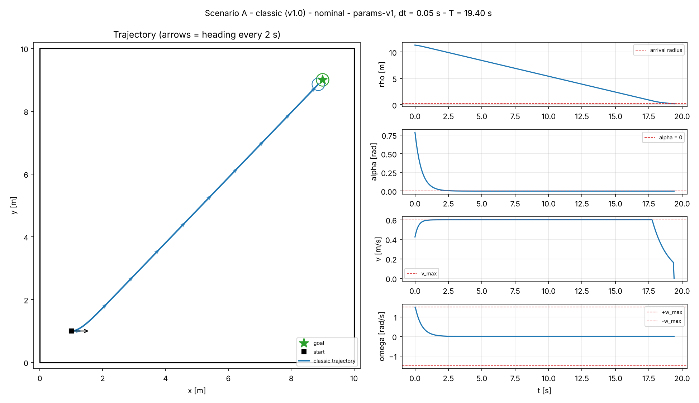
  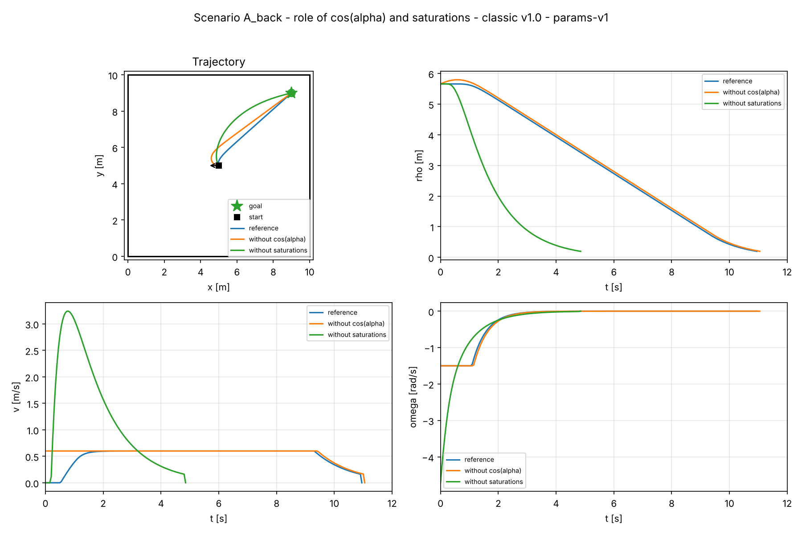
</p>

- **Scenario A:** the classic law arrives in 19.40 s.
- **Target behind the robot:** without the cos α factor, the robot first drives *away* from the target. Without saturation, the commands reach 3.24 m/s and 4.71 rad/s, that is 5.4× and 3.1× the limits.
- **Time step:** halving Δt changes the trajectory by less than 0.3 cm.

---

## Fuzzy engine (session 2)
The chain is **fuzzification → rule activation (AND = min) → implication → aggregation → crisp output**. The inputs are the distance ρ and the bearing α to the target. The outputs are v and ω. The rule base has 15 rules (3 × 5) with two outputs each.

<p align="center">
  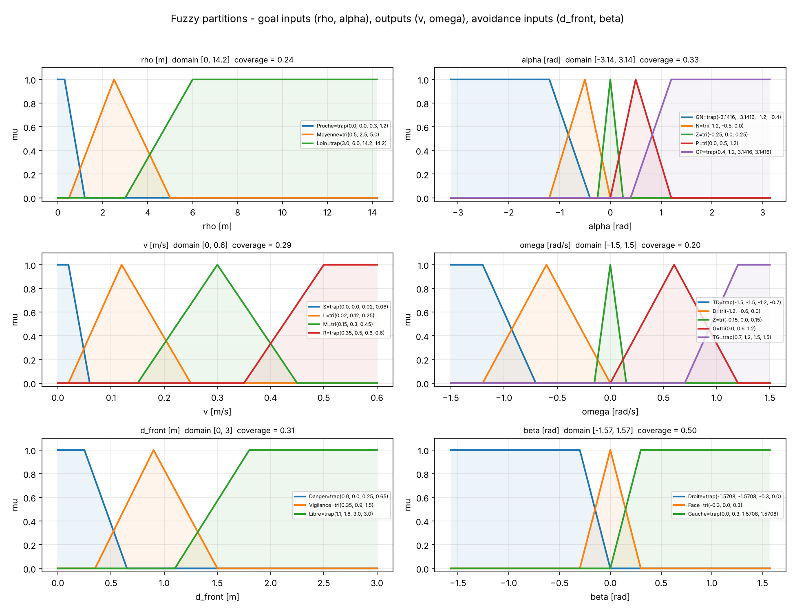
</p>

<p align="center">
  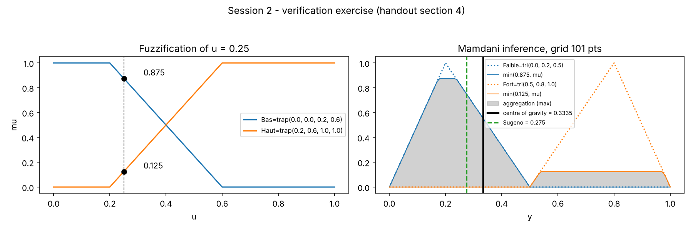
</p>

The notebook [`notebooks/session2_fuzzy_engine.ipynb`](notebooks/session2_fuzzy_engine.ipynb) walks through one complete inference by hand. When no rule fires, the engine reports a diagnostic and the controller applies (v, ω) = (0, 0). Inputs outside their domain are saturated and counted.

---

## Goal seeking: Mamdani vs Sugeno (session 3)
<p align="center">
  
</p>

The two control surfaces are close: they differ by at most 0.066 m/s on v and 0.24 rad/s on ω. The differences come from two places:
- Mamdani's "stop" set has a **positive centroid** (0.021 m/s), so the robot creeps forward while turning, whereas Sugeno outputs exactly 0;
- the Mamdani centroid of "very left" is 1.21, against the Sugeno constant 1.30.

<p align="center">
  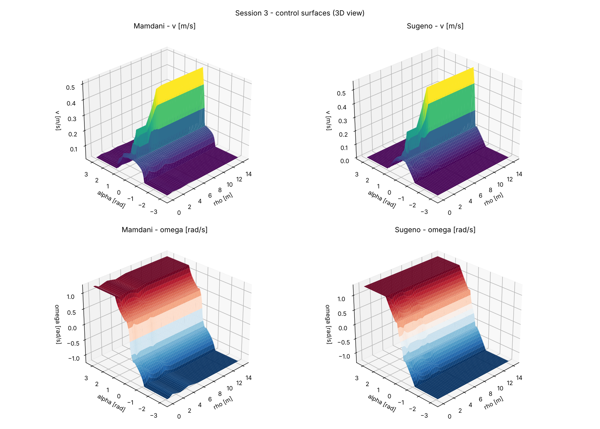
  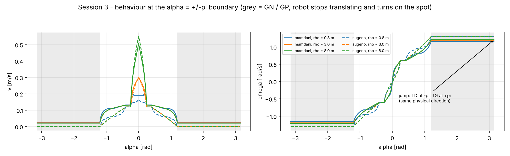
</p>

<p align="center">
  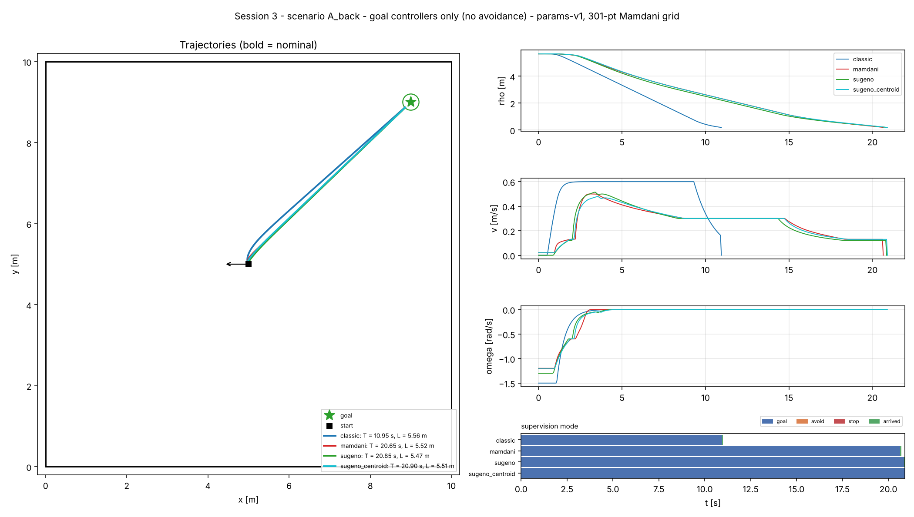
  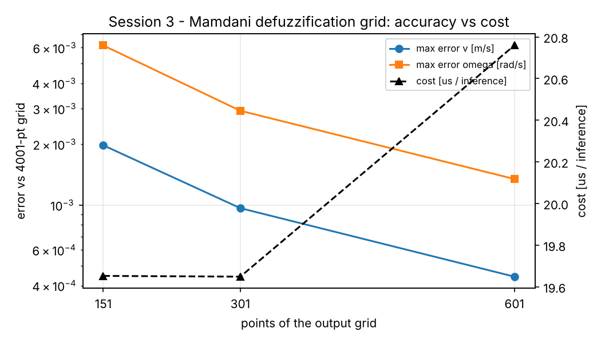
</p>

- **Grid of the Mamdani defuzzification:**

  | Grid points | Max error on ω |
  |---|---|
  | 151 | 6.2·10⁻³ rad/s |
  | 301 | 2.9·10⁻³ rad/s |
  | 601 | 1.3·10⁻³ rad/s |

  The cost per inference barely changes, because it is dominated by Python overhead. Sugeno has no grid and is about 3× cheaper.
- **α = ±π:** this is the same physical direction, but it maps to "turn hard right" on one side and "turn hard left" on the other. The jump is harmless because the robot is told to stop translating there.

---

## Obstacle avoidance and supervision (session 4)
The avoidance controller takes the clearance to the frontal obstacle and its bearing β, with 9 rules. A common supervisor switches between **goal** and **avoid** modes with hysteresis (enter below 1.0 m, leave above 1.4 m). It also applies a preventive stop below 0.15 m, and declares blocking when the robot makes less than 5 cm of progress in 10 s. For a fair comparison, the classic system reuses exactly the Sugeno avoidance.

### The flaw found while tuning
<p align="center">
  
</p>

- **The cause:** in the handout's perception, an obstacle stops being "frontal" as soon as |β| > π/2. The perceived distance then jumps from about 0.8 m to 3 m, the hysteresis is bypassed, and the mode flips at almost every step: **486 switches**, with ω oscillating between +0.6 and −1.3 rad/s.
- **The fix (`sys-v2`):** keep tracking the obstacle being avoided until the robot is really clear of it. This gives **10 switches**, and Σ|Δω| drops from 784 to 192. The price is a longer, scalloped path.
- **Rounding effect:** in v1, Mamdani dodges B on the *right*, because ω = −5.8·10⁻¹⁷ at α = 0. A rounding error decides the side, not the left-hand convention. v2 treats |β| ≤ 0.05 rad as "dead ahead".
- **Protocol:** this change was decided **only from maps B and C**, then frozen.

<p align="center">
  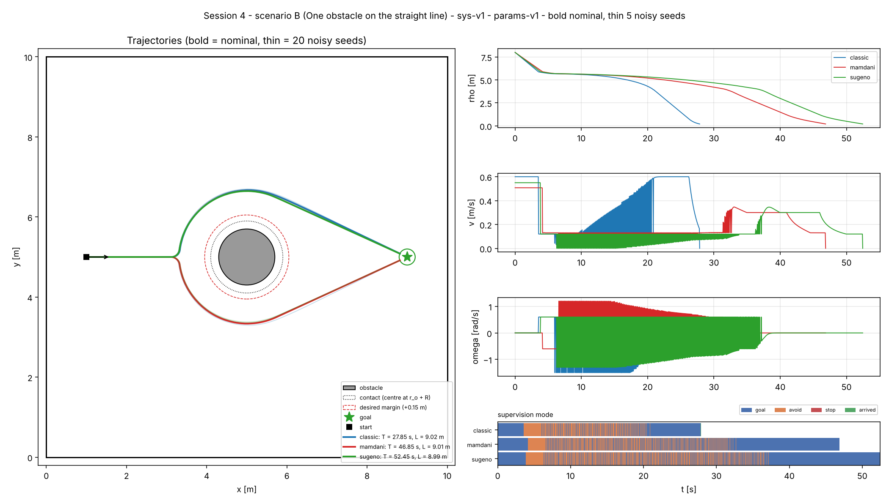
  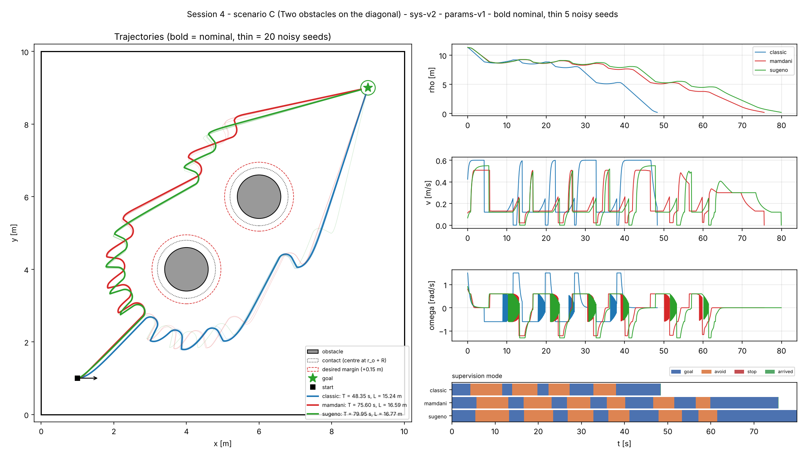
</p>

### Blocking in a concave obstacle
<p align="center">
  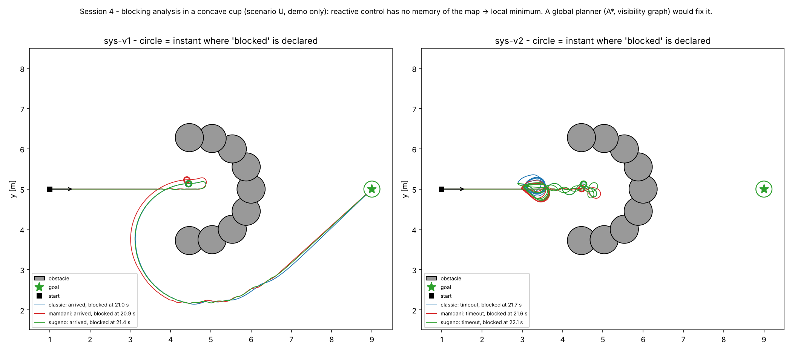
</p>

A purely reactive controller has no memory of the map, so a cup-shaped obstacle is a local minimum. All methods are declared blocked after about 21 s. v1 escapes thanks to its chattering, while v2 stays trapped. A global planner (A* or a visibility graph) feeding waypoints to the fuzzy controller would fix this.

---

## Comparative campaign on the test maps (session 5)
For every method, system version and test map: 1 nominal run plus 20 noisy runs (seeds 0–19). The pose observations get σ = 0.02 m and 0.02 rad of noise.

### `sys-v1` (handout supervisor)
| Map | Classic | Mamdani | Sugeno |
|---|---|---|---|
| D (3 obstacles) | 20/20 arrivals, 42.9 ± 1.0 s | 20/20, 77.1 ± 0.4 s | 20/20, 89.3 ± 0.4 s |
| E (1.2 m passage) | 20/20, 45.9 ± 0.9 s | 20/20, **34.2 ± 0.2 s** | 20/20, 55.8 ± 0.6 s |
| F (start facing away) | 20/20, 30.7 ± 0.2 s | 20/20, 53.4 ± 4.1 s | 20/20, 59.0 ± 7.2 s |

### `sys-v2` (corrected supervisor)
| Map | Classic | Mamdani | Sugeno |
|---|---|---|---|
| D | 20/20, 68.1 ± 1.5 s | 20/20, 95.2 ± 0.2 s | 20/20, 104.6 ± 1.6 s |
| E | 20/20, 81.7 ± 0.7 s · **nominal: timeout** | 20/20, 45.8 ± 0.3 s · **nominal: timeout** | 20/20, 89.0 ± 0.5 s · **nominal: timeout** |
| F | 20/20, 42.5 ± 0.3 s | 20/20, 64.6 ± 0.2 s | 20/20, 66.5 ± 0.2 s |

There were **0 collisions over the 360 test episodes.** Mean times are over the successful noisy runs.

<p align="center">
  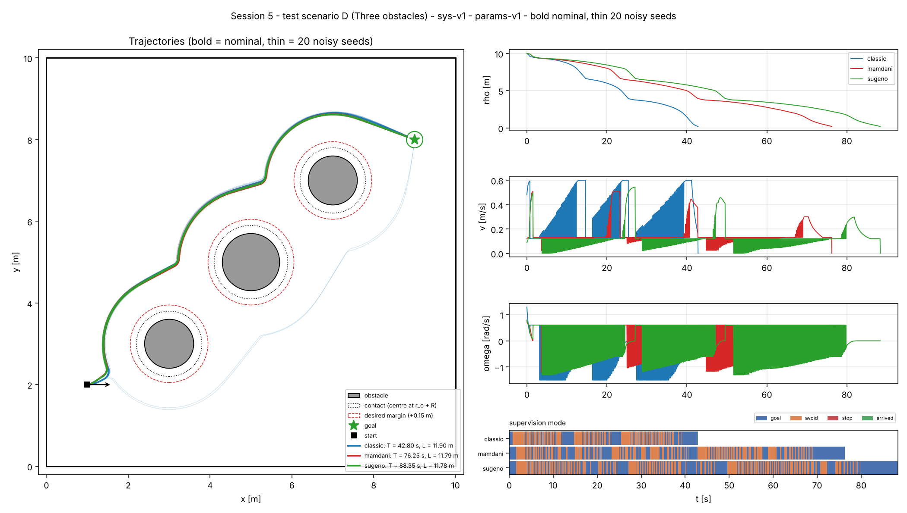
</p>

<p align="center">
  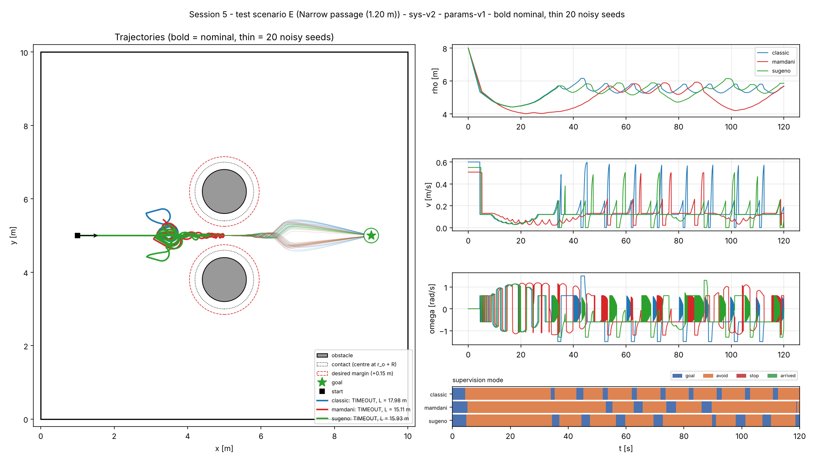
  <br><sub>The symmetry deadlock: on the exact axis y = 5, both obstacles are equidistant, the tracked obstacle keeps swapping, and the robot circles in front of the gap until the 120 s limit. Any noise breaks the symmetry, and all 20 noisy runs get through. This is the only case where noise changes the ranking.</sub>
</p>

<p align="center">
  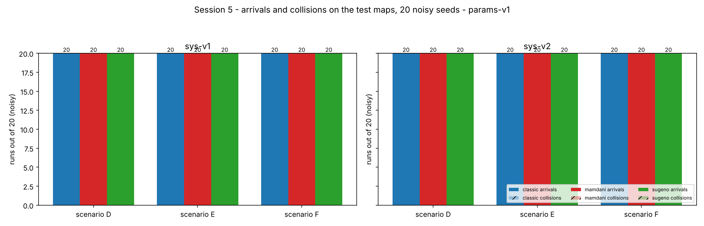
  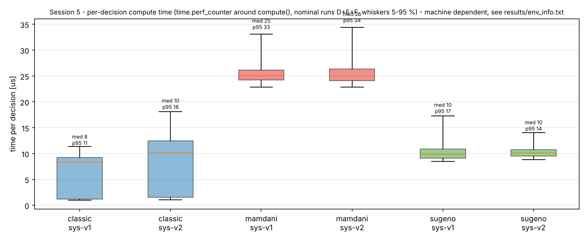
</p>

<p align="center">
  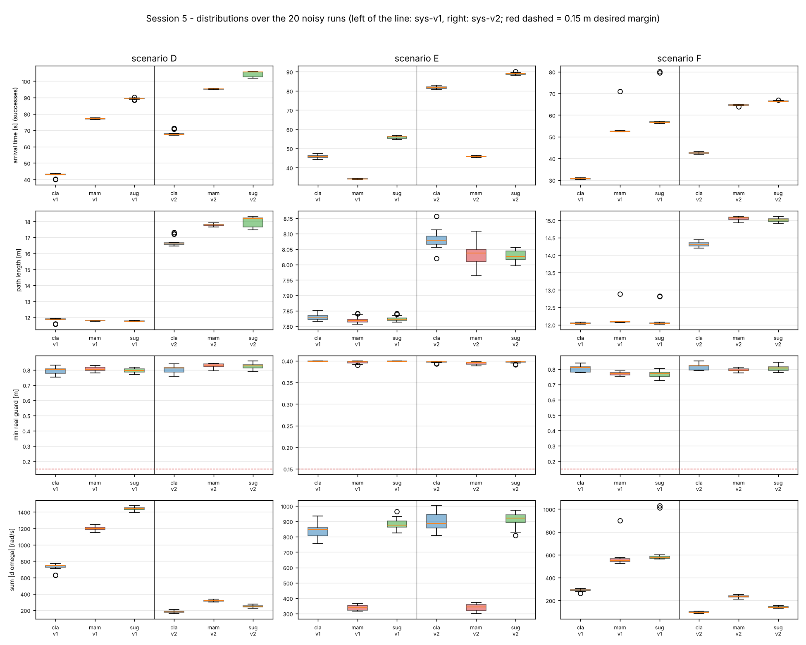
</p>

What drives the results:
- **The classic law is fastest on D and F.** It gets this from its continuous speed profile, v = min(0.6, 0.8ρ).
- **Mamdani is fastest through the narrow passage E.** Its non-zero "stop" output lets it keep moving while turning between the obstacles.
- **The fuzzy controllers are slow near the target.** This comes from the *rule* "close → slow", not from the inference engine.
- **Mamdani costs about 2.5× more per decision than Sugeno**, because of the defuzzification grid.

---

## Extensions: neural imitation and genetic tuning (session 6)

### Option A: MLP imitating the Sugeno goal controller
- **Data:** 10 000 (ρ, α) samples, split 70 / 15 / 15 with seed 42.
- **Inputs and model:** (ρ/14.2, sin α, cos α), an MLP with hidden layers of 32 and 16 neurons.
- **Training:** the epoch is chosen on the validation set, and the training is repeated with 3 initialisations.

<p align="center">
  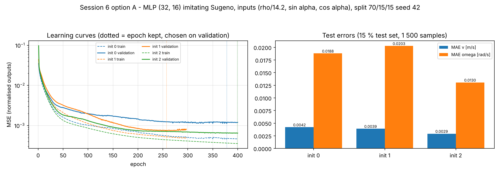
  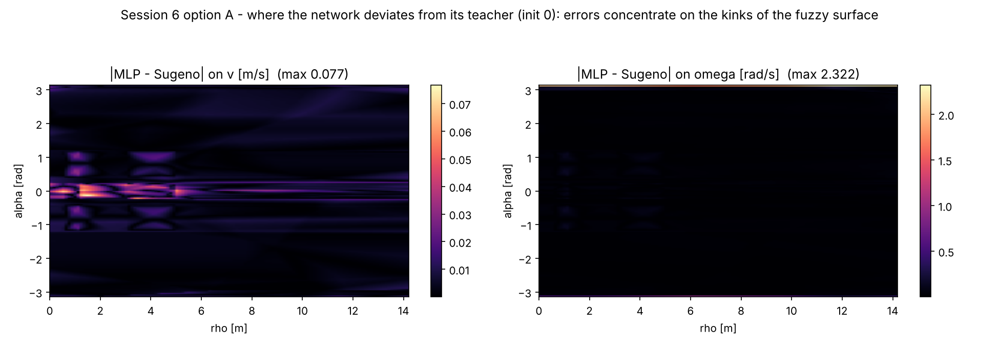
</p>

- **Test error:** 0.003–0.004 m/s on v and 0.013–0.020 rad/s on ω, concentrated on the kinks of the fuzzy surface.
- **In closed loop:** one network takes an 11.0 m detour on map E (instead of 7.8 m). The network with the *lowest* imitation error is the slowest on E in the nominal run (82 s, against 52 s for its teacher).
- **Takeaway:** **a low imitation error does not guarantee good navigation**, and the network only copies an expert policy.

<p align="center">
  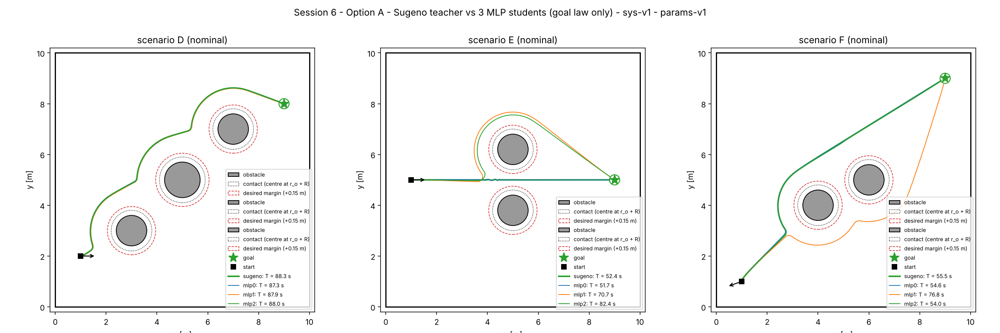
</p>

### Option B: genetic algorithm on (speed factor, turn factor, avoidance threshold)
- **Algorithm:** 12 individuals, 10 generations, tournament of size 3, arithmetic crossover, Gaussian mutation (probability 0.2), elitism.
- **Objective:** minimise J on the tuning maps A and B. J combines collisions, failures, time, path length and margin violations.

<p align="center">
  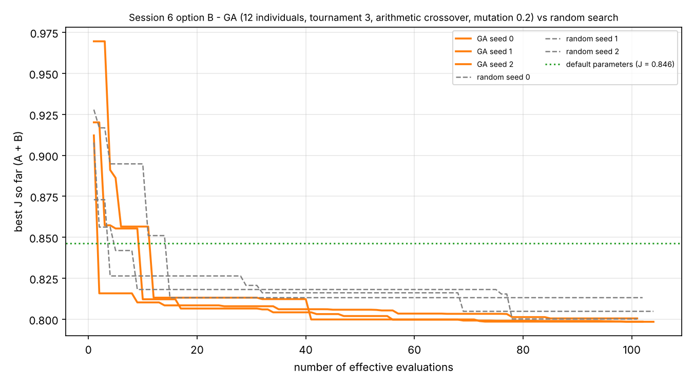
  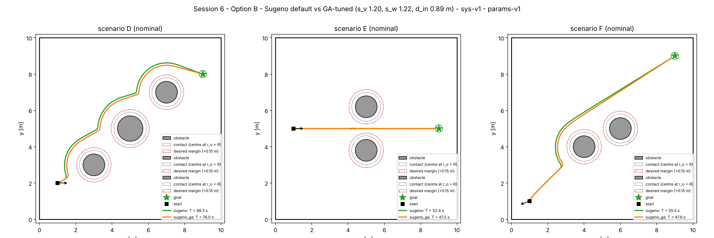
</p>

- **Convergence:** all 3 seeds converge to the maximum speed factor (1.20), and J goes from 0.846 to 0.798.
- **Against random search:** with the same budget (about 102 evaluations), random search reaches 0.800–0.813. The gain from the GA is real but modest for 3 parameters.
- **On the test maps:** the robot is faster (D: 77.1 s instead of 89.3 s), but its minimum clearance drops from 0.80 to 0.68 m. **A weighted score trades safety for speed; it is not a safety constraint.**

---

## Interactive replay viewer
[**Open it online**](https://sarra1011.github.io/soft-computing-robot-navigation/viewer.html), or open `viewer.html` locally. It works offline, in any browser.

- Pick a test map (D / E / F), a supervisor version and a run (nominal or seeds 0–4).
- Play the three robots side by side at up to 20× speed, or scrub through time.
- The trail colour shows the supervisor mode (goal or avoid). Live state, ρ(t), ω(t) and the campaign summary are shown next to the arena.

---

## Run it

### On Kaggle (no install)
1. On kaggle.com: Create → New Notebook → File → Import Notebook → `kaggle/soft_computing_kaggle.ipynb`
2. Click **Run All** (about 8–10 min). Outputs (figures, logs, tables, `viewer.html`) are zipped at the end.

### Locally
```bash
python -m venv .venv
.venv\Scripts\activate          # Linux / macOS: source .venv/bin/activate
python -m pip install -r requirements.txt
python -m unittest discover -s tests -v    # 27 tests
python run_experiments.py                  # full campaign, no manual input
python run_experiments.py --quick          # 2-minute smoke test (5 seeds)
python scenarios.py                        # check the maps
```
Then open `results/RESULTS.md`, the `figures/` folder, and `viewer.html`.

---

## Project layout
| File | Role |
|---|---|
| `model.py` | parameters, kinematics, wheel speeds, collision geometry |
| `sensors.py` | noisy pose observation (noise pre-generated per seed), obstacle perception |
| `fuzzy.py` | fuzzy inference engine (Mamdani, Sugeno), written from scratch |
| `fuzzy_design.py` | partitions and rule tables (15 goal rules, 9 avoidance rules) |
| `controllers.py` | classic, fuzzy, MLP and avoidance controllers, common supervisor |
| `scenarios.py` | maps A–F and demo maps, JSON export |
| `simulator.py` | simulation loop, segment collision check, blocking monitor |
| `metrics.py` | per-episode metrics and aggregation |
| `sessions/` | one runner per lab session (1 to 6) |
| `extras.py` | GIF animations and the interactive viewer |
| `run_experiments.py` | rebuilds every log, table and figure |
| `notebooks/` | step-by-step fuzzy inference |
| `kaggle/` | self-contained Kaggle notebook |

**Outputs:**
- `configs/`: JSON maps and parameters;
- `logs/`: one CSV log per episode, with the true state, observations, commands, mode and status at every step;
- `results/`: summaries and tables;
- `figures/`: all figures.

---

## Limitations
- **Perception is ideal:** the map is known and nothing is ever hidden from view.
- **Kinematics only:** the model has no inertia and no motor model.
- **Simple maps:** obstacles are fixed discs only, and there are 6 evaluation maps.

A difference observed on these scenarios is not a general guarantee. The compute times depend on the machine: they were measured on a Kaggle Intel Xeon @ 2.00 GHz (4 cores).

## Tech
Python · NumPy · Matplotlib · scikit-learn · fuzzy logic (Mamdani, Sugeno) · MLP · genetic algorithms · reproducible experiments
